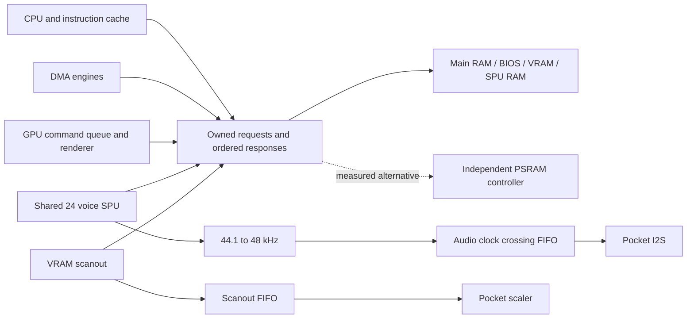

# Pocket roadmap: real sound and approximately 30 fps

Prepared 2026-10-11 from this source snapshot and the local MIRLO64 tree.

**Implementation checkpoint:** [POCKET_START_HERE.md](POCKET_START_HERE.md). Icarus 13.0 is installed. Isolated P04 RTL elaborates in three configurations, and the two P02 cache comparisons are corrected. Simulation, live integration and fresh synthesis remain outstanding. See the [memory contract](POCKET_MEMORY_CONTRACT.md) and [implementation record](POCKET_IMPLEMENTATION.md).

## Objective and assessment

Run original PS1 games on Analogue Pocket with audible music/effects, correct game speed, and approximately 30 **newly rendered frames per second** in selected lighter scenes. Start with PS1 Doom and WipEout; use existing working titles as regression controls. See [benchmark definitions](POCKET_BENCHMARKS.md) and [model assignment instructions](POCKET_MODEL_HANDOFF.md).

There are credible architectural opportunities, but this inspection does **not** establish that the target fits or reaches 30 fps. No synthesis, simulation, or Pocket measurements were performed. The supplied build is silent by design. A meaningful sound implementation and faster execution require more than clock changes.

Agreed priority: **video and approximately 30 fps first, then audio**. The first release gate permits silent output, while retaining the SPU register/DMA behavior needed for games to progress. Reserve resources and memory service for future audio throughout the video work.

Recommended approach:

1. Recover a reproducible Pocket build and measure a baseline.
2. Give memory requests explicit ownership; repair small cache/loader defects.
3. Reclaim the two large internal display buffers by making VRAM authoritative and scanning it out through small buffers.
4. Allow CPU/GPU overlap safely; then optimize the measured memory, texture, and geometry costs and implement rendering features required by the selected scenes.
5. Qualify video at approximately 30 fps and correct game speed on Pocket, with sound explicitly deferred. Measure remaining ALMs, RAM blocks, DSPs and memory bandwidth; stress the memory fabric with representative future audio traffic.
6. Implement one shared SPU datapath serving all 24 voices, plus 44.1-to-48 kHz conversion and Pocket audio output. Add required CD audio, then repeat the frame-rate qualification with sound enabled.

Keep the old rendering route as a temporary comparison configuration while migrating. A configuration that omits required drawing cannot pass the video gate. Missing required sound features prevent the later combined gate from passing.

## Evidence from this code

Line numbers refer to the inspected snapshot; search the named symbols after edits.

| Finding | Source evidence | Consequence |
|---|---|---|
| Build provenance is incomplete | `Pocket/ap_core.fit.summary` names Quartus 18.1.1, `apf_top`, and device `5CEBA4F23C8`; no Pocket QPF/QSF/SDC or APF framework is supplied | Restore the project before optimizing anything whose fit or timing matters |
| Source/generated interface mismatch | `Pocket/core_top.v:655–659` connects `set_bram`, `bram_word_wr`, `bram_wdata`; their declarations are commented in `Pocket/core.sflp:34,40` | The shipped bitstream cannot be assumed to match these exact sources |
| Logic is almost full | Saved report: 17,060 / 18,480 ALMs; 58 / 66 DSP blocks | Only 1,420 ALMs and 8 DSP blocks nominally remain; this is a historical baseline, not a fresh result |
| Physical RAM blocks are almost exhausted | Saved report: 307 / 308 RAM blocks, although memory bits are only 2,406,963 / 3,153,920 | “24% memory free” is misleading: packing and port configuration determine fit |
| Two large internal display buffers | `view_ram_ctrl.sflp:5,20` references and instantiates two missing `ram_320x240x15_dp` blocks | Nominal payload is 2,304,000 bits, about 281 KiB; verify actual per-instance mapping once the missing module is recovered |
| CPU pauses for entire peripheral operations | `PlayStation_core.sflp:177–195`, `peripheral_running` includes GPU drawing/VRAM transfers, DMA, CD and controller work | Even cache-resident CPU work cannot overlap GPU drawing; sharing memory is only part of the slowdown |
| Main RAM, BIOS and VRAM share one path | `Pocket/core.sflp:248–340`; VRAM writes issue one 16-bit beat | Small transactions and serialization are likely expensive; exact latency is unknown because the SDRAM controller is missing |
| Requests and responses depend on serialization | `Pocket/core_top.v:673–678` ORs loader and core requests; `Pocket/core.sflp:260,297` broadcasts SDRAM ack to WRAM/BIOS; `PlayStation_core.sflp:280–394` forwards WRAM ack to multiple engines | Removing stalls before adding arbitration/response ownership risks data corruption |
| Extra external memories are unused | `Pocket/core_top.v:264–286` disables both CellularRAM interfaces | PSRAM is an option for splitting traffic, but it needs a controller and timing validation |
| Screen pixels are not consistently stored in VRAM | `drawPoly.sflp:411–416,476–480`, `drawRect.sflp:44–55,195–197`, `drawFillRect.sflp:133–146` | Display buffers are architectural state today. Simply replacing them with a VRAM reader would lose rendered graphics |
| Presentation uses special cases | `GraphicProcessingUnit.sflp:620–657` has hard-coded display offsets; `Pocket/core.sflp:163–173` reduces large modes | VRAM-based display addressing should replace these cases incrementally |
| VBlank and clocks depend on work being done | `Pocket/core.sflp:177–195` suppresses VBlank begin while drawing/SIO busy; `PlayStation_core.sflp:484–519` clocks many devices from `cpu.run` | Increased FPS can otherwise change timers, controller timing, CD timing and game speed |
| GPU status is approximated | `GraphicProcessingUnit.sflp:288–290` toggles odd/even after status reads | Real display timing must drive status; a polling loop should not advance video state |
| Current “FPS” is a proxy | `Pocket/core.sflp:152–200` counts display-flip notifications or VGA events | It is not proof of completed, distinct game frames or correct game speed |
| Audio is explicitly disabled | `Pocket/core.sflp:218–220`; SPU memory handlers commented at `317–350`; `Pocket/core_top.v:719–762` sends silence | Enabling one flag cannot restore sound |
| Existing SPU is expensive | `DigitalSignalProcessor.sflp:27–29` instantiates 24 `dsp_ch` units; each has decode/envelope/volume arithmetic in `dsp_ch.sflp:71–98` | Reuse behavior and tests, but investigate a shared datapath rather than reinstating all voice hardware |
| Existing audio cadence needs care | `DigitalSignalProcessor.sflp:249–259` advances channels at 176.4 kHz and reverb at 22.05 kHz | A new 44.1 kHz scheduler must preserve pitch/envelope semantics, not replace a divider blindly |
| Definite cache validity expression defect | `Cache_IR.sflp:103` and `Cache_Texture.sflp:153` repeat `offset==0` and omit `offset==1` for the third word | A suffix fill starting at word 1 leaves a fetched word invalid, causing avoidable misses |
| Palette locality is barely exploited | `drawPoly.sflp:438–474`, `drawRect.sflp:209` onward cache only the last CLUT entry | Alternating palette indices can generate many external reads despite texture cache hits |
| GPU functionality is incomplete | Line draw dispatch commented/no-op at `GraphicProcessingUnit.sflp:410–445`; VRAM copy `0x80` only consumes arguments at `483–488`; semitransparency stage commented in `drawPoly.sflp:490–507`; rectangle modulation flags have no implementation | Visually simple 2D games may still need substantial compatibility work |
| Texture invalidation needs specification | GP0 `0x01` is a no-op at `GraphicProcessingUnit.sflp:330`; texture cache has reset/debug clear but no normal command clear input | Implement documented cache behavior; indiscriminately making caches coherent can also differ from PS1 behavior |
| Movies are stubbed | `MDEC.sflp:65` forces a size of 64; `126–178` skips decoding and schedules a delay | FMV-dependent boots are a compatibility gate, not evidence that the CPU is too slow |
| Disc reads are demand-loaded | `Pocket/core.sflp:471–498` keeps one 4 KiB SRAM window, serves bytes; `core_top.v:583–589` ignores `target_dataslot_err` | Streaming and failures need explicit handling before CD music is dependable |

Additional loader risks requiring reproduction: bridge write pulses cross clock domains while data is sampled separately; `apf2sram` fills its whole 4 KiB address space even for short reads, using `^ram_reloading` to keep progressing. These are audit findings, not experimentally confirmed corruption.

## Build recovery inventory

This folder has no `.git` directory. `sflp`, `sfl2vl`, `quartus_sh`, `verilator`, and `iverilog` were not found on this session's PATH. Do not infer that they are installed or usable because MIRLO64 contains installer downloads.

Missing Pocket dependencies include:

- The SFL preprocessing/compiler toolchain, versions, and invocation details. The root Makefile uses `sflp` and `sfl2vl -O2`.
- `ram_320x240x15_dp.sflp`/header/RTL, used by `view_ram_ctrl.sflp`. The included `ram_320x240x15.sflp` is a different interface.
- `../../../Pocket/sram_ctrl.h` and its implementation.
- `../../../hdl/USB-JTAG/DE0-CV/vjtag_uart.h` and its implementation.
- `sdram128_burstn_ctrl_100`, `main_pll_0002`, `synch_3`, `core_bridge_cmd`, `apf_top`, pin assignments and constraints.
- A Pocket-specific source manifest. The root Makefile also lists absent `view_ram_ctrl_one.sflp` and `pseudo_cdrom_data.sflp`; it does not build `Pocket/core.sflp` as a dedicated target.

Recover dependencies from upstream or a pinned donor with appropriate notices. If original build recovery fails, create a documented replacement platform while retaining available PS1 logic. Do not spend the whole project translating SFL to SystemVerilog: use wrappers for isolated new blocks first.

Snapshot identifiers:

```text
bitstream.rbf_r SHA256 f787b8e0fe23d754a357fc7935da55cff845efd5d39a272f071b10912346c4c5
Pocket/core_top.v     737dfd1c4630b7cfa0e464eb5b6420f404f0f403ff71b31a53674b0931fc87f2
Pocket/core.sflp      eae06396af663b6f20c56c7171a3d4a2ba4487f1cd2db7607ea9862181d69ef6
PlayStation_core     1e08033f78c2446294d08df5a8fb797ed16024f9fa137fe8a533e089ec2b5c49
```

## Architecture and resource budget

Pocket provides 64 MiB SDRAM, two separate 16 MiB PSRAM chips, and 256 KiB asynchronous SRAM. These are external memories; they do not add FPGA logic or internal RAM blocks. See [Analogue external hardware](https://www.analogue.co/developer/docs/openfpga/external-hardware).

Start with a tagged SDRAM fabric and the existing logical memory map. Give scanout and sound bounded service time. Evaluate an independent PSRAM path only against measured contention and resource cost.

| Data | Initial proposed placement | Design requirement |
|---|---|---|
| 2 MiB PS1 main RAM | SDRAM | CPU cache-line reads, masked writes, ordered DMA |
| 1 MiB authoritative VRAM | SDRAM | All rendering, uploads, copies and readback share the same backing store |
| 512 KiB BIOS | SDRAM | Keep loader addressing consistent |
| 512 KiB SPU RAM | SDRAM initially; benchmark PSRAM0 if latency requires it | Explicit DMA, sample fetch, capture and IRQ semantics; reserved service budget |
| Disc cache | Existing SRAM, enlarged beyond 4 KiB after profiling | Bounded fills, valid tags, cancellation and error propagation |
| Scanout buffer | Small internal FIFO/line buffers | Size from worst-case service latency, not average bandwidth |
| Voice state / decoded sample windows | Internal RAM | Indexed state for all 24 voices and shared arithmetic |
| Optional temporary presentation buffers | PSRAM1 or reserved SDRAM | A migration option only; preserves old output but does not fix VRAM correctness |

Two 320×240×15 buffers contain 288,000 bytes: they do not both fit in 256 KiB SRAM. One 320×240×16 buffer uses 153,600 bytes. Two to four 320×16-bit scanout lines need only 1,280–2,560 bytes, but more buffering may be necessary after measuring worst-case stalls. Reclaimed block count must come from Quartus, since the original dual-port memory implementation is missing.

Planning arithmetic, **not measured throughput**:

- 320×240×30 = 2.304 million displayed pixels/s. At 50 MHz there are about 21.7 clocks per displayed pixel, shared with other work; overdraw increases the actual requirement.
- One 16-bit write per final pixel is 4.608 MB/s. Scanout at 60 Hz adds 9.216 MB/s. Textures, CLUT reads, blending, overdraw, DMA and row changes add traffic.
- A 100 MHz ×16 SDRAM interface has a 200 MB/s theoretical data rate. The actual clock is unverified without the missing PLL; sustained efficiency must be measured.
- 50 MHz / 44,100 is about 1,134 fabric clocks per stereo sample, or 47.2 per voice before shared work. A scheduler must budget worst-case pitch, refill, envelopes, mixing, DMA and reverb.
- 44.1-to-48 kHz conversion uses the exact source/output ratio 147/160. Preserve PS1 pitch and event timing; do not drive Pocket at 44.1 kHz.

Engineering targets, subject to the recovered fit: free at least 32 RAM blocks before committing to new queues/state RAM; aim for at least 10% ALM/DSP headroom before the full audio integration. These are planning gates, not predicted savings. Count physical RAM blocks as well as bits. Every milestone requires setup/hold/recovery/removal timing checks where applicable, including external I/O and clock crossings.



## What to borrow from MIRLO64

Read-only donor inspected at `/Users/dst/Documents/koodi/MIRLO64`, HEAD `1ab630b989cd4862ea20cb323f47c6087972b4ef`. The only reported untracked files were tool installers. Pin a donor revision and preserve file-specific notices if copying.

| Donor files | Useful content | Adaptation boundary |
|---|---|---|
| `platform/pocket/*`, `target/pocket/core_bridge_cmd.v`, `projects/mirlo.qsf` | APF shell, pin/build structure | Use a minimal PS1 project, not the entire N64 source manifest |
| `rtl/soc/sdr_ctrl.sv`, `sdr_phy.sv`, `sdr_arb.sv` | Open rows, tagged responses, burst grants, explicit acceptance | Donor accepts 32-bit word addresses; PS1 wrapper uses 16-bit addresses and up to 128-bit returns. Recalculate clock ratios, timing and byte lanes |
| `rtl/soc/n64_video.sv`, `afifo.sv` | External scanout and epoch-tagged clock crossing | Current video FIFO has 16,384 entries ×37 bits, not a tiny line buffer. Reuse the pattern and choose a PS1 budget; omit N64 filters |
| `target/pocket/audio.sv`, `sound_i2s.sv`, `mf_audio_pll*` | Stereo FIFO, PLL and serializer | Add full/empty protection, deterministic reset and measured underruns. Check channel ordering and I2S edge alignment |
| `rtl/soc/rcp_ai.sv` | Linear interpolation and FIFO-fill control | Extract sample conversion concepts; its N64 DMA/register/interrupt behavior is not PS1 SPU behavior |
| `rtl/soc/psram.sv` | Potential CellularRAM bring-up reference | Not instantiated in current MIRLO64. Drives both chips together as a 32-bit memory; not a drop-in independent PSRAM controller |
| `tools/area2/closure.py`, `entity_table.py`, `cmp_entities.py` | Area and multi-corner timing summaries | Replace hard-coded project/clock names; make missing reports an error |
| `docs/fps.md` | Honest limits of frame-origin counters | Its overlay counts a presentation proxy too; do not use that alone for acceptance |

MIRLO64's local README explicitly limits its recorded evidence: simulated boot/title progress, no comprehensive per-game Pocket playability/FPS record, and tight seed-dependent timing. The user subsequently supplied firsthand Pocket observations: Tony Hawk runs with only small dips below 30 fps in the first level; Mario Kart runs fairly steadily; “wave rider” runs; Star Fox runs with dips in polygon-heavy scenes; Mario 64 runs. See [the observation record](POCKET_BENCHMARKS.md#user-reported-mirlo64-hardware-results).

These reports extend the available evidence beyond the donor README and strengthen the case for studying its working memory, rendering and platform architecture. Exact versions, bitstream, FPS measurement method and audio state were not supplied, so these are qualitative hardware reports rather than controlled benchmarks or proof of PS1 performance. The donor's default seed is documented as having a hold violation; the user's working build is not identified with that seed, and the PS1 project still needs independent timing qualification.

MIRLO64 uses Apache-2.0 for its own material, with MIT/BSD/APF/vendor exceptions in `NOTICE`. The current PS1 project is MIT. Record provenance per copied file and retain the applicable notices.

## Task assignments and order

LLM tiers refer to capability, not brand or subscription:

- **L1 — economical coding model:** bounded edits, manifests, parsers and documentation under an explicit specification.
- **L2 — strong coding model:** independently implements a small RTL block and meaningful tests; understands state machines, fixed-width arithmetic and handshakes.
- **L3 — strongest reasoning model available, with demonstrated RTL competence:** cross-module design, concurrency, fixed-point correctness and resource tradeoffs. Request a written design and invariants before edits.
- **H — FPGA engineer / hardware operator:** review and board measurements needed in addition to an LLM. Model quality cannot substitute for TimeQuest evidence or a physical Pocket.

Size is relative scope: S = one bounded patch; M = several patches; L = subsystem work; XL = architectural migration. It is not an elapsed-time promise.

| ID | Task | Minimum tier | Size | Depends on | FPGA/hardware gate |
|---|---|---|---|---|---|
| P00 | Reconstruct reproducible Pocket build | L3; delegate manifests to L1 | L | — | H: constraints and first boot |
| P01 | Instrumentation and benchmark capture | L2; result tooling L1 | M | P00 for execution | H: baseline runs |
| P02 | Cache suffix-fill validity fixes | L2 | S | P00 | Focused simulation + fit |
| P03 | Loader transactions, reset and CDC | L3 | M | P00 | H: SD/bridge stress |
| P04 | Memory ownership and arbitration | L3 | L | P00, P01 | H: external RAM timing |
| P05 | Pocket PCM/I2S output and resampler | L2, L3 review | M | P00; resource gate | H: recorded audio |
| P06 | Authoritative VRAM and external scanout | L3 | XL | P01, P04 | H: video and bandwidth |
| P07 | Shared SPU engine and SPU RAM | L3 | XL | P04; P06 or equivalent proven space | H: sound and deadline stress |
| P08 | CPU/GPU overlap and GP0 FIFO | L3 | L | P01, P04; coordinate P06 | H: game regressions |
| P09 | Guest timing, VBlank and IRQ behavior | L3 | L | P01, P08 | H: real-time behavior |
| P10 | Texture/CLUT locality and burst writes | L2, L3 review | M | P02, P04, P06 | Timing/fit + game captures |
| P11 | CD streaming, CDDA and XA | L3; packaging tools L2 | L | P03, P04, P05, P07, P09 | H: game music/streaming |
| P12 | GTE resource sharing, if needed | L3 | L | P01, fresh area report | H: geometry and timing |
| P13 | GPU compatibility gaps | L2 per primitive; L3 integration | L | P04, P06 | Exact VRAM fixtures + games |
| P14 | MDEC, when a selected scene requires it | L3 | L | P04, measured free resources | H: movie and return to play |
| P15 | Controls and memory-card persistence | L2; CDC review L3 | M | P03, P04 | H: save/reload, Pocket/Dock |
| P16 | Combined qualification and release | L3; reports L1 | M | Required tasks above | H: final sound + FPS proof |

Immediate low-cost delegation: prepare P00's dependency manifest, P01's result schema, and P02's isolated tests. Do not assign the shared-memory, renderer or SPU redesign to a budget model working without review.

### P00 — Reproducible build

**Inputs:** root Makefile, Pocket source/JSON, saved fit report, missing dependency list, donor APF shell.

**Implement:** a pinned source/dependency manifest; Pocket-specific generation/build/package commands; explicit SFL compiler versions; complete project and constraints; simulation models for vendor IP. Reconcile commented ports with generated `core` interface. Keep generated outputs separate. Preserve original encodings/newlines; several SFL comments are non-UTF-8. Record tool version, device, flags, seed, source hashes and bitstream hash.

**Done when:** a clean checkout can produce a fitted, timing-qualified bitstream and BIOS/demo output. Archive warnings, hierarchy resources and timing reports. If the original platform cannot be recovered, document replacements and baseline differences. Byte-identical output is not required without the original toolchain/seed, but do not claim source-to-binary equivalence.

### P01 — Observability before speed work

**Touch:** `Pocket/core.sflp`, `PlayStation_core.sflp`, GPU/cache/DMA interfaces, new benchmark tooling.

**Implement:** counters for elapsed wall-clock cycles, retired CPU instructions, GPU busy cycles, per-reason CPU stalls, memory acceptance/completion/wait, texture and CLUT misses, bytes moved, APF fill latency/errors, VBlank delivery, audio FIFO minimum level/underruns, SPU deadline misses. Use a mutually exclusive stall-priority counter for a total breakdown, plus optional overlapping raw causes. Define instruction retirement at architectural completion; `cpu.run` is not an instruction count.

Snapshot counters coherently across domains. Expose a compact debug page/JTAG record; build instrumentation selectively to fit. Keep display-flip count labeled as a proxy and add completion/dirty-frame evidence. Implement cold-boot deterministic input replay where possible.

**Done when:** baseline captures use the benchmark schema, synthetic workloads verify counters, and counter overhead has a measured fit/performance cost. Hardware FPS values remain unfilled until measured.

### P02 — Cache validity defects

**Touch:** `Cache_IR.sflp:103`, `Cache_Texture.sflp:153`.

**Implement:** fix the duplicated comparison so offset 1 fills mark the third word valid. Preserve the existing suffix-fill protocol. Review all four offset cases, data alignment, replacement tags and reset/clear behavior.

**Done when:** focused tests fill from each offset and probe every word; only fetched words hit, data matches, replacement misses correctly, and reset clears validity. Demonstrate the extra hit for a word-1 fill. This is a small performance fix, not a promised frame-rate jump.

### P03 — Loader and clock-domain reliability

**Touch:** `Pocket/core_top.v:503–616`, `Pocket/core.sflp:362–537`.

**Implement:** explicit transaction length/validity; coherent request parameters; queue/handshake for bridge writes; completion only after received data is committed; reset cancellation; error/timeout propagation; short/partial final-block handling. Replace the implicit repeating fill of short reads with valid byte counts. Use explicit cache-valid state rather than sentinel addresses alone. Reject malformed EXE ranges and detect file/BIOS errors deterministically.

**Done when:** randomized clock phases and bridge gaps cannot lose/duplicate writes; 2-byte, 256-byte, 4096-byte and partial-EOF loads work; error/reset injection exits cleanly; failed loads never report success. Validate bridge throughput/backpressure against APF requirements.

### P04 — Owned memory requests

**Touch:** `Pocket/core_top.v:673–703`, `Pocket/core.sflp:248–350`, `PlayStation_core.sflp` DMA and CPU memory wiring.

**Implement:** first write an interface contract separating request acceptance, read completion and write visibility. Define address units, byte lanes, burst boundaries, reset, outstanding-request limit, and owner IDs. Add adapters for the SFL request/ack behavior, which sometimes holds requests until ack and sometimes treats ack as availability. Do not assume the missing controller returns a one-cycle pulse.

Initially allow one outstanding request if simpler. Route completion only to its owner; replace OR-combined loader/core commands. Then evaluate MIRLO64's tagged controller or improve the recovered controller. Reserve bounded service for scanout/SPU and enforce fairness for CPU/DMA. A repeated urgent request must not starve other clients indefinitely.

**Done when:** a scoreboard covers simultaneous masters, read/write collisions, byte/halfword/word accesses, line bursts, row boundaries, refresh and reset. Prove no lost or duplicate transfers. Report sustained bandwidth and worst latency under the intended mixed load. Any PSRAM alternative must independently pass initialization, masks, refresh/WAIT, turnaround and I/O timing checks.

### P05 — Pocket audio output

**Touch:** replace silence generation in `Pocket/core_top.v`; add PCM FIFO, rational resampler and serializer wrappers.

**Implement:** stereo signed 16-bit 48 kHz output, deterministic resets, FIFO-full handling and underrun counters. Use a PLL or a fully constrained clock scheme. Adapt the MIRLO64 serializer/FIFO carefully: audit empty reads, paired sample capture and reset behavior. Convert a 44.1 kHz input stream using exact rational phase progression; linear interpolation is acceptable for the first audible milestone. This conversion is separate from interpolation inside the SPU.

**Done when:** signed ramps and independent left/right tones decode correctly from simulated I2S, including the one-bit delay; recorded Pocket audio has correct pitch and channel order; reset/flush does not create persistent noise; ten-minute sample accounting shows no accumulating rate error. A generated tone proves output plumbing only.

Pocket requires 48 kHz, 16-bit stereo I2S and 12.288 MHz MCLK; see [Analogue bus/audio specification](https://www.analogue.co/developer/docs/openfpga/bus-communication).

### P06 — Recover internal RAM through correct VRAM rendering

**Touch:** `drawPoly.sflp`, `drawRect.sflp`, `drawFillRect.sflp`, `GraphicProcessingUnit.sflp`, `view_ram_ctrl.sflp`, `Pocket/core.sflp`.

**Implement in separately reviewable steps:**

1. Add a VRAM pixel sink and write every committed rasterized pixel to its real 1024×512 location; retain old `view_on` output for comparison. Respect clipping, masks, transparency and command order. Eliminate the `x < 640` distinction as a backing-store decision.
2. Add scanout using display origin, width, height, stride and color-depth state. Start with selected low-resolution noninterlaced modes. Prefetch lines/bursts through an asynchronous FIFO; count missed deadlines and present defined output on underflow.
3. Compare output and VRAM readback, then switch Pocket output to the new path and remove the two full internal display buffers.
4. Implement remaining modes only as required by measured benchmark boot/gameplay paths, keeping unsupported modes explicit.

**Done when:** draw → GP0 readback and draw → texture sampling observe the same pixels; alternating display origins, in-place updates, uploads and display-disable work; resource reports demonstrate reclaimed blocks; mixed memory load produces no scanout underruns. New VRAM writes add bandwidth compared with the old shortcut—budget them before removing the fast display path.

### P07 — Small shared SPU

**Touch:** `SoundProcessingUnit.sflp`, `DigitalSignalProcessor.sflp`, `dsp_ch.sflp`, `ADSR.sflp`, `DMA_SPU.sflp`, Pocket memory integration; new SV block permitted behind an SFL wrapper.

**Implement in three milestones:**

1. Accurate SPU registers, transfer FIFO, 512 KiB backing RAM, DMA and IRQ behavior; one ADPCM voice with loop/end flags, pitch and ADSR.
2. Indexed state for 24 voices and one scheduled decode/interpolation/envelope/mix datapath. Retain all voices. Preload small ADPCM windows to hide RAM latency. Define worst-case work per sample, including high pitch and simultaneous refills.
3. Connect P05, then finish Gaussian interpolation, noise/pitch modulation, capture and reverb as demanded by the target audio traces. If temporarily omitted, label the result partial audio and keep the milestone separate from full sound acceptance.

Use independent behavioral fixtures to check rounding, sign extension, saturation and envelope evolution. The existing source is useful but is not an unquestionable oracle. Keep sample generation independent of render stalls. At 50 MHz, prove the complete 24-voice schedule fits within about 1,134 clocks/sample including memory wait; add margin and a deadline counter. Reverb may use its own scheduled phase rather than multiplying hardware per voice.

**Done when:** test samples, multi-voice mixes and register/DMA traces agree with a pinned reference; no missing voices, timing-dependent hangs or deadlines missed under full GPU/CD load; original-game music/effects are audible at correct pitch. Sound specifications and measured SPU sequencing are described in [psx-spx SPU research](https://psx-spx.consoledev.net/soundprocessingunitspu/).

### P08 — CPU/GPU overlap

**Touch:** `PlayStation_core.sflp:177–195`, `GraphicProcessingUnit.sflp:253–321`, `DMA_GPU.sflp`, memory adapters.

**Implement:** a GP0 input FIFO distinct from the existing command assembly buffer; accepted/ready backpressure; command-state snapshots so later register writes cannot mutate the current primitive. Preserve GP1 ordering/reset rules and correct GPU status/DMA request behavior. Permit CPU execution while GPU draws only when resources and dependencies allow it. Start with cache hits/independent execution; broaden to WRAM traffic through P04. Audit DMA priority/chopping and register visibility.

**Done when:** the CPU makes measurable progress during GPU drawing; queue full, GP1 reset, CPU/DMA concurrent submissions, VRAM readback and linked-list termination work; instruction and device event traces remain valid. Simply deleting `gpu.drawing` from `peripheral_running` is not an implementation.

### P09 — Stable guest time

**Touch:** `PlayStation_core.sflp:480–555`, `Pocket/core.sflp:177–208`, `Timer.sflp`, GPU status.

**Implement:** document fabric time, guest clock enables, CPU advancement and display time separately. Correct peripheral time progression while CPU waits; implement timer clock sources/synchronization needed by tests; drive VBlank/odd-even from video timing rather than status reads or GPU idle. Remove existing timing workarounds one at a time after trace comparisons. Keep sound playback wall-clock deadlines independent of emulated CPU stalls.

**Done when:** fixed-duration input replays match expected game progress, IRQ order and timer values across light/heavy GPU loads. No FPS gain may come from running the game faster or slowing audio. Preserve BIOS/demo and existing-title boot behavior. This task is high risk because the current compatibility behavior relies on coupled clocks.

### P10 — Texture and memory efficiency

**Touch:** cache, polygon/rectangle CLUT paths, pixel sink and DMA_GPU.

**Implement according to P01 profiles:** small CLUT cache or palette preload; explicit GP0 texture-cache clear behavior; burst/coalesced adjacent pixel writes; instruction/DMA burst improvements. Define flush/forwarding before readback, texture reads, copies, blending or completion. Preserve ordering and PS1 cache semantics rather than invalidating everything on every write. Consider a CPU store buffer only after traces show it matters; it needs forwarding and fences at relevant I/O/DMA boundaries.

**Done when:** identical raster/VRAM fixtures, lower measured memory requests or wait cycles, and improved benchmark frame time with a net resource budget. Stress alternating palette indices, palette changes and overlapping source/destination regions.

### P11 — Streaming and CD sound

**Touch:** `CDROM_controller.sflp`, Pocket file window, `data.json`, SPU mixer.

**Implement:** more than one valid disc-cache window or a sector ring; asynchronous read-ahead; ordered completion and seek cancellation; track metadata and formats needed by the selected dump. The existing BIN/IMG/EXE selector has no CUE/track metadata path. Add a documented CUE conversion/descriptor workflow or native metadata loading before claiming multi-track CDDA. Decode XA separately from SPU ADPCM and mix CDDA/XA through the proper controls.

**Done when:** data loads and sound streams coexist without starving SPU/scanout; file errors, track boundaries, seeks, partial final windows and pause/resume work. Verify music and effects separately. WipEout's sound pass includes disc music, not only engine effects. A 64 MiB SDRAM cannot hold a whole normal game CD, so this requires streaming.

### P12 — GTE area recovery, conditional

**Touch:** `GeometryTransformationEngine.sflp`, `gte_DIVIDE.sflp`, `gte_LIMIT.sflp`, CPU COP2 sequencing.

**Implement:** rank actual synthesized multiplier/mux/limiter costs. Share arithmetic between mutually exclusive operations, register long paths, or use a sequenced MAC where measured throughput permits. Source declares shared multipliers and additional stage-local multipliers; fitter results determine what survives. Preserve intermediate width, truncation, saturation/FLAG behavior, reciprocal quirks and register FIFOs.

**Done when:** command fixtures cover RTPS/RTPT, MVMVA, lighting/color, clipping, overflow, divide extremes and register transfers. Report both saved resources and extra cycles per command. Reject a smaller GTE that causes the chosen 3D benchmark to miss its frame budget. Do this earlier only if area blocks P05/P07.

### P13 — Required GPU semantics

**Implement as individual tasks:** VRAM-to-VRAM copy and overlap rules; line/polyline parsing and rendering; texture modulation/windowing; semitransparency and mask bits; low-resolution display mode handling. Prioritize from captured benchmark command traces. Use [GPU specifications and observations](https://psx-spx.consoledev.net/graphicsprocessingunitgpu/) and emulator behavior to resolve edge cases.

**Done when:** deterministic command streams produce expected VRAM images, including negative coordinates, clipping, odd transfers and degenerate primitives. Long polylines cannot overflow a fixed command buffer. Test complete gameplay images; command consumption without drawing is a failure.

### P14 — MDEC only when needed

**Implement:** measured minimum complete decode path—command FIFOs, DMA, RLE, inverse quantization/IDCT and color conversion—using scheduled arithmetic. Replace the fixed-delay placeholder only with explicit command/status semantics.

**Done when:** synthetic blocks match reference output and a selected game passes movie playback and return to gameplay. A documented normal Start-button movie skip may be used for an early gameplay benchmark; it is not a passed FMV test. Do not make full MDEC a prerequisite for the first audible gameplay milestone if selected scenes can boot without it.

### P15 — Controls and persistence

**Touch:** `PAD_controller.sflp`, `Pocket/core.sflp:211–238`, Pocket input/interact/data definitions and loader.

**Implement:** practical L2/R2 mapping for handheld controls, sensible Dock input, debug toggles that do not steal game actions, actual memory-card backing and APF persistence. Keep card saves separate from full-machine savestates.

**Done when:** benchmark routes can be completed on Pocket; save → quit → reload restores data, and failed writes preserve prior saves. A controller protocol acknowledgement alone does not prove persistence.

### P16 — Qualify the combined design

**Implement:** reproducible release packaging plus a completed benchmark report. Run focused regressions after each subsystem change; reserve full hardware qualification for the combined bitstream. At this utilization, require full timing reports rather than a “Fitter Successful” line. Document clocks, constraints, unconstrained-path audit, I/O timing, fitter seed, resource totals and retained margins.

**Done when:** the benchmark contract passes with sound enabled, complete graphics for the scenes, correct game progression, no video/audio underflows or hangs, and repeatable physical Pocket results. If 30 fps is missed, report the measured limiting subsystem and next bounded experiment instead of declaring success from a menu or duplicated frames.

## Suggested milestone sequence

| Milestone | Required result |
|---|---|
| M0 | P00 + P01: reproducible source build, BIOS/demo, honest hardware baseline |
| M1 | P02–P04: cache fixes and safe memory/loader behavior with no game regression |
| M2 | P06: correct VRAM scanout and reclaimed internal RAM; reserve space for future audio |
| M3 | P08–P10, P13, conditional P12 and necessary P14/P15: correct selected-scene rendering and measured CPU/GPU overlap |
| M4 | First P16 qualification: approximately 30 fps video at correct game speed, silent output explicitly permitted; publish remaining resource/bandwidth budget |
| M5 | P05 + P07 + required P11: real game audio, including required disc music, without losing M4 performance |
| M6 | P16: approximately 30 fps with audio in the combined release candidate |

Task IDs remain stable; their numbers do not define execution order. Defer P05/P07 and the audio portion of P11 until M4. Pull forward P11's data-streaming work only if game loading requires it. P12 may precede M2 when fit data justifies it. Independent models can prepare fixtures and isolated blocks concurrently, but one integrator must own shared interfaces and cross-subsystem edits. M4 does not prove future sound will fit: preserve the resource targets above and remeasure the combined design at M6.
